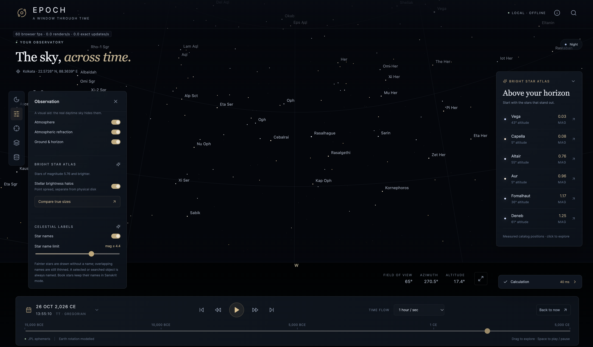

# Epoch — Offline Sky Simulator

A local astronomical observatory that shows the sky from any place on Earth between **15,000 BCE and 5,000 CE**. It has a React/Three.js interface and a Python/FastAPI scientific service. Once set up, it runs fully offline.

## Interface preview



*Visual preview of Epoch's local sky-view interface.*

## Requirements

| Tool | Version | Used for |
| --- | --- | --- |
| [Python](https://www.python.org/downloads/) | 3.12 or newer | scientific backend and data setup |
| [Node.js](https://nodejs.org/) (includes npm) | 20 or newer | building the web interface |
| [Git](https://git-scm.com/downloads) | any recent | getting the code |

- **Python packages** (installed from `backend/requirements-lock.txt`; direct requirements in `backend/requirements.txt`): fastapi, uvicorn, numpy, scipy, astropy, pyerfa, jplephem, rebound, reboundx, galpy, httpx, pytest.
- **JavaScript packages** (from `frontend/package.json`): react, react-dom, three, lucide-react; for the build, typescript and vite.
- A C compiler/build toolchain may be needed for scientific packages such as REBOUNDx when no wheel is available (Xcode Command Line Tools on macOS, corresponding C build tools on Linux/Windows).
- **Disk and network:** about 10 GB of free space for installation, including retained resumable download shards and dependencies. Setup downloads **3.43 GB of JPL kernels** plus Python/JavaScript packages. The repository includes a compact prepared scientific-data bundle; saved playback frames are excluded. Runtime needs no internet.

## Setup (once, online)

```bash
git clone https://github.com/24ssuman/Epoch.git
cd Epoch
./setup.sh --check
```

On Windows, or to choose a particular Python interpreter, use `python scripts/setup_local.py --check` (`python3` or `py -3.12` may be appropriate). Activation of a virtual environment is unnecessary: setup creates and uses the checkout's own `.venv`. Node.js/npm must already be installed. The shell shortcuts support macOS/Linux; use the Python commands on Windows.

Setup installs locked Python and JavaScript dependencies, verifies/unpacks the prepared runtime data, downloads the official DE440/DE441 kernels with resumable ranges, checks their pinned SHA-256 hashes, builds the interface, and runs backend/frontend tests plus offline installation checks. All environments, downloads and caches stay inside the checkout. Plain `./setup.sh` performs installation/build without the optional checks.

The prepared bundle includes star catalogs and stellar trajectories, measured diameters, Sanskrit labels, comet windows and brightness calibration, JPL constants/asteroid states, and current deep-time planetary results with seed/calibration parameters. It avoids repeating the long scientific calculations during installation. Sources, licenses, units, frames and limitations are documented in the [prepared-data guide](data/prepared/README.md).

An interrupted setup can be rerun with the same command. Completed matching files and bounded kernel ranges are reused. Modified prepared inputs are preserved in local setup backups before replacement; a mismatched existing kernel is preserved and setup stops with instructions. Setup never distributes, clears or needs an existing playback database. New exact frames are cached locally as you use the app.

## Run

macOS / Linux:

```bash
./run.sh
```

Windows:

```powershell
.venv\Scripts\python.exe -m uvicorn backend.app:app --host 127.0.0.1 --port 8765
```

Open **http://127.0.0.1:8765/** in a browser. Stop the server with Ctrl+C.

## Use

- Drag to look around and use the mouse wheel to zoom. Pick a location or enter coordinates, and set the date in the date dialog or on the timeline. Dates are in **TT** (Terrestrial Time); BCE/CE and Julian/Gregorian calendars are supported.
- Search stars, planets and comets by name or HIP number, and click one to inspect it. Settings let you switch atmosphere, names (including Sanskrit names), grids and constellation lines.
- Planets before about 13,200 BCE use the bundled reduced-model results. Their reports describe numerical checks and physical limits; these are extrapolations. Background reconstruction controls remain available for research work.

## Check that it works

The [clean installation report](docs/INSTALLATION.md) records the verified environment, downloaded-data hashes and offline checks.

```bash
./setup.sh --check
```

## Limitations

Results are calculated from JPL ephemerides (DE440/DE441), the Hipparcos/HYG star catalog and cached JPL comet data. Coverage of the full date range does not mean every object can be reconstructed accurately over it: dates before DE441 are reduced-model extrapolations, and ancient Earth rotation and local clock times are uncertain. See [coverage and accuracy](docs/README.md#coverage-and-accuracy) and [scientific methods](docs/SCIENCE.md).

## More details

- [frontend/README.md](frontend/README.md): full guide to the interface and its controls
- [backend/README.md](backend/README.md): API, caching, star limit, and changing the date range
- [scripts/README.md](scripts/README.md): data setup, background reconstruction, cache pruning, NASA cross-check
- [docs/README.md](docs/README.md): coverage, accuracy, scientific methods and validation
- [data/README.md](data/README.md): data sources and licenses
- [tests/README.md](tests/README.md): what the tests check

Sanskrit-name sources and their limits are documented in the [frontend guide](frontend/README.md#sanskrit-name-sources), with online links to the texts containing the names.
